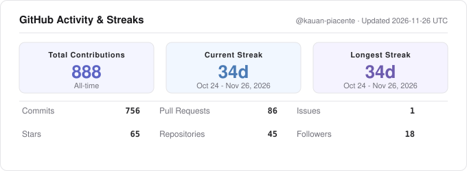
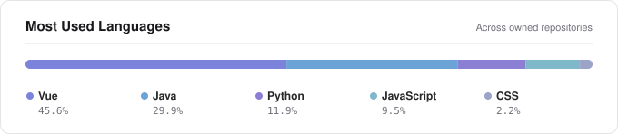

# Kauan Piacente

**Systems Analysis and Development Student** · **Junior Automation Technician**

---

### About

- **Education:** Systems Analysis and Development at **Senai Roberto Mange**
- **Experience:** Junior Automation Technician at **HI Tecnologia**
- **Focus:** Software and systems development, backend engineering, and clean architecture

---

### GitHub Stats

  <picture>
    <source media="(prefers-color-scheme: dark)" srcset="./assets/stats-dark.svg" />
    <source media="(prefers-color-scheme: light)" srcset="./assets/stats-light.svg" />
    
  </picture>

  <picture>
    <source media="(prefers-color-scheme: dark)" srcset="./assets/langs-dark.svg" />
    <source media="(prefers-color-scheme: light)" srcset="./assets/langs-light.svg" />
    
  </picture>

---

### Tech Stack

---

### Featured Projects

| Project | Description | Stack | Link |
| :--- | :--- | :--- | :--- |
| **Project One** | *Add a brief one-line description of what it solves.* | `Python` `Systems` | [Repository](#) |
| **Project Two** | *Add a brief one-line description of what it solves.* | `Java` `Backend` | [Repository](#) |
| **Project Three** | *Add a brief one-line description of what it solves.* | `JavaScript` `Web` | [Repository](#) |

---

  Stats automatically updated via GitHub Actions

